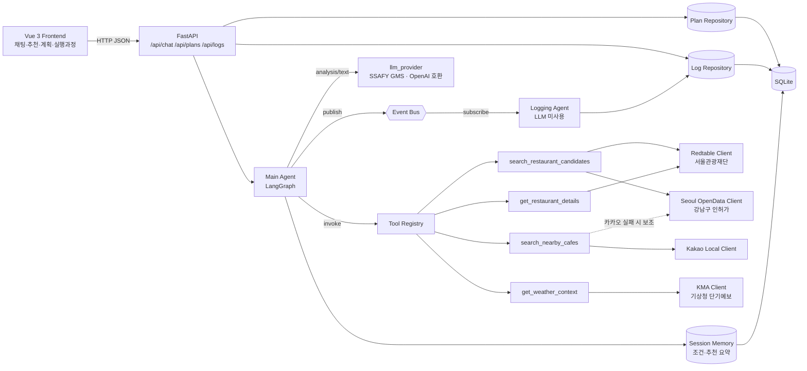
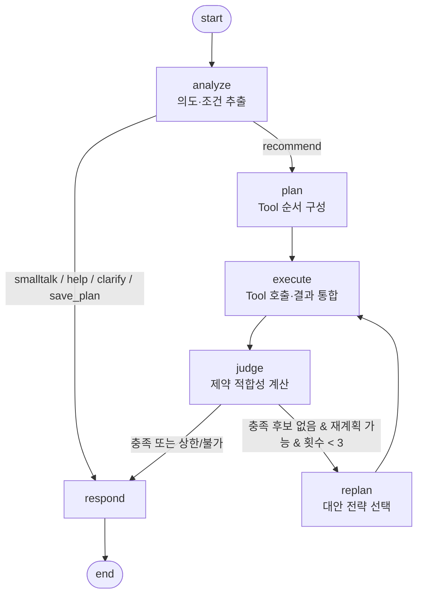

# 밥카공 아키텍처

## 1. 시스템 구성

- 발행자(Agent)는 `EventBus.publish()` 만 호출하고 구독자를 모른다. 로깅 Agent 가 없거나 실패해도 Agent 는 동작한다.
- 계획 저장은 Tool 이 아니다. 사용자가 이미 고른 코스를 저장하는 작업이므로 API/실행 흐름이 직접 저장소를 호출한다.

## 2. 메인 Agent 그래프 (F3005~F3011)

### 상태(AgentState)

| 키 | 내용 |
|---|---|
| `session_id`, `run_id` | 세션·실행 식별자 (모든 이벤트에 포함) |
| `message` | 이번 사용자 발화 |
| `previous` | 직전 조건·추천 요약 (Memory, 원본 응답 미포함) |
| `intent`, `intent_reason`, `decided_by` | 의도와 이유, 판단 주체(llm/rule) |
| `conditions` | 기준(date, meal_time, cafe_time) / 선호(area, food_type, prefer_short_walk) / 제약(budget_max, max_walk_m) — 추출 못 한 값은 null |
| `plan` | `[{step, tool, args_from}]` |
| `tool_cache` | `(tool, args) → result` — 재계획 시 재사용 |
| `tool_calls` | 호출 이력 (순서, 소요 시간, ok/error) |
| `evaluation` | 후보별 충족 여부·계산값·제외 사유·점수 |
| `replan_count`, `replan_history` | 재계획 횟수와 전략 |
| `response` | 최종 구조화 응답 + 문장 |

### 재계획 정책 (F3009, NF3004)
- 충족 후보가 0건일 때만 재계획, 상한 `MAX_REPLANS=3`.
- 재시도해도 결과가 같은 실패(`MISSING_API_KEY`, `INVALID_INPUT`)는 재계획하지 않고 바로 안내.
- 전략 순서: ① 상세정보 미조회 후보 다음 묶음 조회 → ② 다음 묶음 → ③ 인접 역(강남↔역삼) 같은 조건 탐색.
- 이미 호출한 `(tool, args)` 는 `tool_cache` 에서 재사용(재호출 없음).
- 상한 도달 시 중단하고 사유 + 조건 조정 제안(예산 상향, 음식 종류 변경, 거리 완화)을 응답.

### 제약 판단 계산식 (F3008)
| 판단 | 사용 값 (출처) | 계산 |
|---|---|---|
| 예산 | 메뉴 가격 `price_krw` (레드테이블 메뉴정보) | 예산 이하 메뉴 존재 여부, 최저가. 가격 미확인 → 판단 불가(제외), 역산 기준 "X원 이하 메뉴 존재 여부를 매장에서 확인" 제시 |
| 영업시간 | `business_hours` (레드테이블 운영정보) | `HH:MM~HH:MM` 파싱 가능 시 식사 시각 포함 여부. 파싱 불가/미확인 → '미확인'(제외하지 않되 순위 하락·경고) |
| 휴무일 | `holidays` | 방문 요일명이 포함되면 제외 |
| 거리 | 후보 `distance_m` (역 기준 직선거리), 카페 `distance_m` (식당 기준, 카카오) | 제약 `max_walk_m` 이하. 도보시간은 직선거리×1.3÷67m/분 추정치로 별도 표기 |
| 날씨 | 기상청 TMP, POP, PTY | §3 정책으로 가산점만 부여 |

## 3. 날씨 기반 추천 정책 (밥카공 초기 정책, 기상청 공식 기준 아님)

설정 위치: `backend/app/agent/policy.py` (`WeatherPolicy`)

| 조건 | 정책 |
|---|---|
| 기온 ≤ 5°C | 메뉴명에 온열 키워드(찌개·탕·국밥·전골·칼국수·라멘·우동·샤브 등)가 있는 후보 가산점 |
| 기온 ≥ 28°C | 냉 키워드(냉면·메밀·소바·물회·콩국수·냉모밀 등) 후보 가산점 |
| 강수확률 ≥ 60% 또는 강수형태 비/눈 | 직선거리가 확인된 가까운 식당·카페 가산점, 카페 검색 반경 축소 |
| 그 외 / 날씨 미확인 | 취향·예산·거리 중심 기본 정책 |

- 강제 제약 → 확인된 데이터만 사용 → 날씨는 가산점만. 사용자의 명시 선호를 날씨로 무시하지 않는다.
- 키워드에 해당하지 않는 메뉴는 온열/냉 여부를 판단하지 않는다(중립).

## 4. 대화 맥락 (F3010)
- 보관: 직전 조건(conditions), 추천 요약(식당·카페 이름/출처/ID/좌표, 날짜·시각), 마지막 의도.
- 보관하지 않음: 외부 API 원본 응답, 메뉴 전체 목록.
- 후속 요청은 새로 추출된 필드만 덮어쓴다. "처음부터/새로" 는 초기화.

## 5. 이벤트 (F3012)
| type | payload |
|---|---|
| `stage_start` / `stage_end` | stage, (end) summary |
| `llm_decision` | decision, reason, decided_by (llm/rule) |
| `plan_created` | steps |
| `tool_call` | tool, args |
| `tool_result` | tool, ok, error_code, duration_ms, summary |
| `replan` | count, reason, strategy |
| `error` | code, message (사용자 노출 가능 문장) |

공통 필드: `session_id`, `run_id`, `seq`, `timestamp`.
